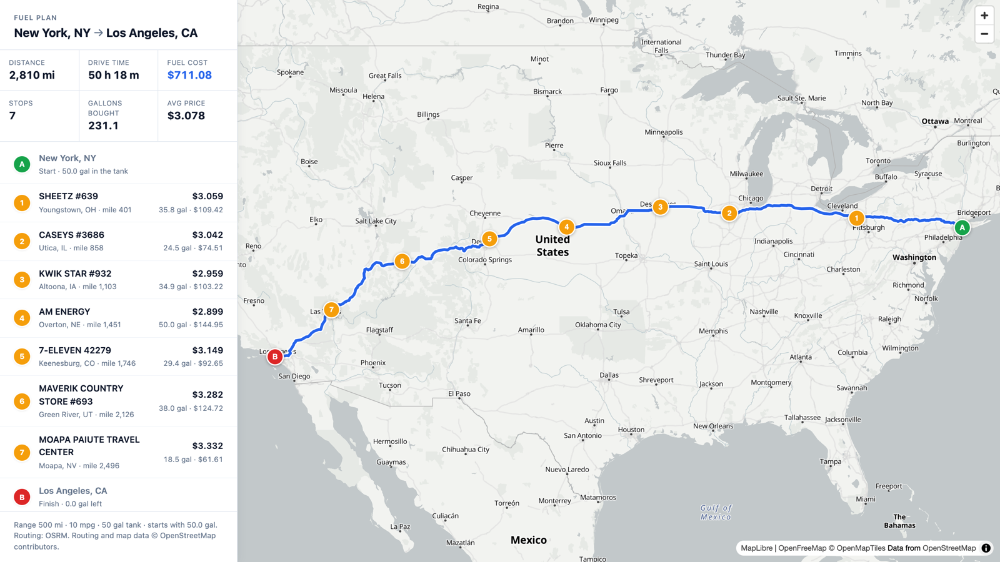

# Fuel Route API

A Django REST API that takes a start and a finish anywhere in the USA and returns the driving route, where
to fuel up along it for the least money, and what that fuel costs. The vehicle has a 500-mile range and
does 10 miles per gallon. Fuel prices come from the truck stop price list in `data/`.

By default the truck leaves with a full tank, so the total is the fuel bought on the way. Give
`start_fuel_gallons` and `end_fuel_gallons` the same value and the total covers all the fuel the trip burns.

```
GET /api/v1/route/?start=Chicago, IL&finish=Denver, CO
```

Route plus fuel plan in one response, with **one** call to the routing service (none when the route is
already cached). Finding the stations along the route and choosing the stops takes about 15 ms, even coast to
coast.



## Demo video

A four-minute demo is included in the repository: [`docs/fuel-route-api-demo.mp4`](docs/fuel-route-api-demo.mp4)
(3:57, 1080p). It shows the API answering requests in VS Code's REST Client, the map page, the tests and a quick
tour of the code. GitHub doesn't play videos in the browser: download it from the file's page, or play it from a
clone.

## Running it

**Docker** (nothing else needed; settings go in an optional `.env`, see `.env.example`):

```bash
docker compose up --build
# http://localhost:8000/api/v1/route/?start=New%20York,%20NY&finish=Los%20Angeles,%20CA
```

**Locally** (Python 3.12+; settings are environment variables, see `.env.example`):

```bash
python -m venv .venv && source .venv/bin/activate
pip install -r requirements-dev.txt
python manage.py migrate
python manage.py import_fuel_prices      # ~2 s: 6,738 stops, coordinates included
python manage.py runserver
```

A Postman collection with example requests, tests and a map visualization is in `postman/`; `requests.http` has
the same requests for the VS Code REST Client or the JetBrains HTTP client.

## API

### `GET /api/v1/route/` or `POST /api/v1/route/` (JSON body)

| Parameter | Required | Default | |
|---|---|---|---|
| `start`, `finish` | yes | | `"City, ST"`, `"City, State"`, a ZIP code, `"lat,lon"`, or a free-form address |
| `max_range_miles` | no | 500 | vehicle range on a full tank |
| `mpg` | no | 10 | fuel economy |
| `start_fuel_gallons` | no | full tank | fuel on board at the start |
| `end_fuel_gallons` | no | 0 | fuel to arrive with, at least; equal to the start fuel, the total covers all the fuel burned |
| `stop_penalty` | no | 5 | dollars charged per stop *when choosing* stops (see below); 0 gives the strictly cheapest plan |

The response echoes the planning options in `options`.

Response (route geometry shortened):

```json
{
  "start":  {"query": "Chicago, IL", "label": "Chicago, IL", "latitude": 41.837045, "longitude": -87.684939, "resolved_by": "place"},
  "finish": {"query": "Denver, CO", "label": "Denver, CO", "latitude": 39.76185, "longitude": -104.881105, "resolved_by": "place"},
  "route": {"distance_miles": 1002.7, "duration_hours": 17.79, "provider": "osrm"},
  "summary": {
    "total_fuel_cost": 145.98, "currency": "USD", "number_of_stops": 2,
    "gallons_purchased": 50.28, "average_price_per_gallon": 2.903, "fuel_used_gallons": 100.28
  },
  "fuel_stops": [
    {
      "number": 1, "opis_id": 70467, "name": "QUIKTRIP #598", "address": "I-80, EXIT 439, SR-370",
      "city": "Omaha", "state": "NE", "latitude": 41.151661, "longitude": -96.15458, "location_precision": "exit",
      "miles_from_start": 480.0, "off_route_miles": 0.0, "price_per_gallon": 2.927,
      "fuel_on_arrival_gallons": 2.0, "gallons_purchased": 7.78, "cost": 22.77
    },
    {
      "number": 2, "opis_id": 52548, "name": "Henderson Fuel Mart", "address": "I-80, EXIT 342",
      "city": "Henderson", "state": "NE", "latitude": 40.821013, "longitude": -97.812765, "location_precision": "exit",
      "miles_from_start": 577.8, "off_route_miles": 0.0, "price_per_gallon": 2.899,
      "fuel_on_arrival_gallons": 0.0, "gallons_purchased": 42.5, "cost": 123.2
    }
  ],
  "vehicle": {"max_range_miles": 500.0, "mpg": 10.0, "tank_gallons": 50.0, "start_fuel_gallons": 50.0, "end_fuel_gallons": 0.0},
  "options": {"stop_penalty": 5.0, "end_fuel_gallons": 0.0, "corridor_miles": 5.0},
  "map": {
    "url": "http://localhost:8000/api/v1/route/map/?start=Chicago%2C+IL&finish=Denver%2C+CO",
    "geojson": {"type": "FeatureCollection", "features": ["route line, start, finish and one point per stop"]}
  },
  "meta": {
    "external_api_calls": {"routing": 1, "geocoding": 0, "total": 1},
    "route_cached": false, "stations_considered": 163,
    "timings_ms": {"geocoding": 0.0, "routing": 1266.6, "planning": 5.8},
    "attribution": "Routing and map data © OpenStreetMap contributors."
  }
}
```

Note the first stop: it buys only 7.8 gallons, just enough to reach a station 98 miles on that is 2.8 cents
cheaper, and buys the rest of the trip's fuel there. The trip burns 100.28 gallons; the first 50 were in the
tank at the start. With `start_fuel_gallons=25&end_fuel_gallons=25` the plan buys all 100.29 gallons the trip
burns (three stops, $295.19).

The map comes in two forms: `map.geojson` (renders as-is in geojson.io or any GIS tool), and `map.url`, an
HTML page that draws the same plan on an interactive map. The page re-uses the cached route, so opening
it costs no routing call.

### Other endpoints

- `GET /api/v1/route/map/?start=...&finish=...`: the interactive map page.
- `GET /api/v1/health/`: number of stations loaded and the routing providers.
- `GET /`: links to the above.

### Errors

Every error the API reports has the same shape: `{"error": {"code": "...", "message": "...", ...}}`.

| Status | `code` | When |
|---|---|---|
| 400 | `invalid_request` | missing or invalid parameters (`fields` says which) |
| 422 | `location_not_found` | the start or finish can't be found |
| 422 | `location_outside_usa` | it resolves to a point outside the USA (swapped `lat,lon` gets a hint) |
| 422 | `no_route` | no drivable route between the two points |
| 422 | `no_fuel_stop_in_range` | a stretch of the route has no station within range (`gap_start_mile`, `gap_end_mile`) |
| 422 | `start_fuel_too_low` | the fuel at the start reaches no station (`reach_miles`, `first_station_mile`) |
| 429 | `throttled` | more than 60 requests a minute from one client (`API_RATE_LIMIT`) |
| 503 | `upstream_unavailable` | the routing or geocoding service can't be reached |

## How it works

```
start, finish ──► resolve locations ──► one routing call ──► stations along the route ──► choose stops
                   (offline)            (cached)             (KD-tree, ~5 ms)            (DP, ~10 ms)
```

### 1. The price list

`data/fuel-prices-for-be-assessment.csv` has 8,151 rows but 6,738 truck stops: 678 stops appear several times
with prices up to $0.90 apart, and 26 rows are exact duplicates. `import_fuel_prices` keeps every price row
(`FuelPrice`) and gives each stop (`TruckStop`) the mean of its prices, so one noisy row can't make a stop look
cheap. It also repairs mis-encoded names (`Stuckey’s` → `Stuckey’s`). 112 stops in Canada are kept but
never used: their prices aren't comparable, and the trips are in the USA.

### 2. Where the stations are

The file has no coordinates, and its addresses describe highways (`I-44, EXIT 283 & US-69`), which street
geocoders can't resolve. Geocoding 6,600 addresses on every start-up would also be slow and abuse free services.
So the stations are located once, and the result is committed as `data/station_locations.csv`
(`manage.py locate_stations` rebuilds it):

- **Exit precision (3,464 stops).** The address has an exit number, and OpenStreetMap has a motorway junction
  with that number within 25 miles of the stop's town. Exit numbers restart in every state, so the town picks
  the right one. One Overpass query fetches every numbered motorway junction in the contiguous US; junctions
  outside the US outline are dropped. The match uses the exit number, not the highway: for 375 stops another
  junction with the same number is near the town (usually on another highway), and the nearest one is taken.
- **Town precision (3,162 stops).** The town's point from the US Census Gazetteer, or from Nominatim for the
  144 places the Census doesn't list. These positions are approximate: the distance from the route is the
  town's, and the map says so.

### 3. Start and finish without extra calls

`"City, ST"`, ZIP codes and coordinates are resolved offline, from Census Gazetteer files in `data/`
(51k place names, 34k ZIP codes). That leaves the routing request as the only external call. Anything else
(`"Empire State Building"`) goes to Nominatim once and is cached. Coordinates are checked against the US state
outlines (1:500,000 Census boundaries), so Tijuana, Windsor and Toronto are rejected while Key West and
Honolulu are accepted.

### 4. One routing call

The route comes from the public OSRM server: one request returns the full geometry, distance and duration.
If OSRM fails (no answer, an HTTP error or a rate limit) the request falls back to Valhalla, also keyless;
only then are two calls made.
Routes are cached for a week by rounded coordinates, so repeated trips, map pages and
different vehicle settings for the same trip cost no call. Every response reports exactly how many external
calls it made (`meta.external_api_calls`).

### 5. Stations along the route

The route (thousands of points) is resampled to at most 0.5 miles between points and put in a KD-tree on
the sphere (`scipy.spatial.cKDTree`). One query returns every station within 5 miles of the road, its
distance from it (the detour), and its mile marker along the route. Coast to coast that's ~350
candidates in about 5 ms.

### 6. Choosing the stops

This is the fixed-route "gas station problem". The classic greedy is optimal when fuel is the only cost:
buy just enough to reach the next cheaper station in range, otherwise fill up. Two things it doesn't handle
matter here:

- **Detours.** A station 3 miles off the interstate costs 6 miles of fuel to use.
- **Tiny stops.** When prices fall slowly along the way, the cheapest plan stops every 50 miles to buy a few
  gallons. Coast to coast that's 13 stops to save $3.71 over 7 stops. "Optimal mostly means cost
  effective", so each stop carries a small cost (`stop_penalty`, default $5) when stops are chosen. The
  reported cost is fuel only.

So the planner (`planner/optimizer.py`) is a dynamic program over *(station, fuel in the tank)* that is exact on
a grid of fuel levels, counted in steps of 0.25 miles of range:

```
cost[f]  = cheapest way to be at the current point with f steps of fuel
drive    : cost shifts by the distance driven
stop at i: arrive with a = f - detour, buy up to t (a < t ≤ tank):
           cost'(t) = min over a ≤ t-1 of (cost(a) - a·p) + t·p + penalty   ← a running minimum
```

Because the price is linear, the best purchase for every target level is a running minimum (one
`numpy.minimum.accumulate`). A station costs O(K) and the whole plan O(n·K), here n ≈ 350 stations and
K = 2,000 fuel levels. It takes about 10 ms. Backtracking the stored decisions gives the stops.

The grid only chooses the stops; the amounts are exact. The grid's rounding goes into the detours and always
rounds up, so a plan that works on the grid works with the real distances. The amounts for the chosen stops
then come from the classic greedy, which is optimal once the stops are fixed. So every plan adds up exactly:
it never arrives with less than nothing and never fills past the tank.

The tests check it against independent solvers on hundreds of random instances:
- Without detours or penalty it equals the **linear-program optimum** (`scipy.optimize.linprog`).
- With detours and penalties it equals the **mixed-integer optimum** (`scipy.optimize.milp`).
- With distances off the grid it stays within 10 cents of the mixed-integer optimum, and replaying each plan
  with the exact distances never runs dry or overfills.

### Assumptions

- The vehicle starts with a full tank (`start_fuel_gallons` changes that) and may finish nearly empty
  (`end_fuel_gallons` sets a minimum). "Total money spent" is the fuel bought along the way, so a trip within one
  tank costs $0; with the same start and end fuel it is the cost of all the fuel the trip burns.
- No reserve: a stop may be reached with an empty tank.
- The vehicle can buy any amount at a stop; prices are the list prices in the file.
- Distances are rounded up by less than a mile per leg when choosing stops, so a leg that would leave less
  than a mile of fuel to spare counts as out of range.
- Routes are for cars (the public OSRM server has no truck profile); a truck profile is a configuration change
  with a self-hosted OSRM or Valhalla (`costing: truck`).

## Project layout

```
config/       settings (all overridable by environment variables, see .env.example), URLs, WSGI
stations/     TruckStop/FuelPrice models, CSV import, station geolocation, in-memory station index
planner/      the API: location resolution, routing client, corridor search, optimizer, views, map page
geo/          plain geometry: distances, point-in-polygon, polyline decoding, simplification, gazetteer
data/         price file, station coordinates, Census places/ZIP codes/boundaries (all committed)
scripts/      build_geodata.py: rebuilds the Census files in data/
docs/         the README's map image and the demo video (fuel-route-api-demo.mp4)
postman/      Postman collection and environment
tests/        pytest suite (no network: HTTP is mocked; `pytest -m live` hits the real routing service)
```

## Tests

```bash
pytest              # 109 tests, ~3 s, no network
pytest --cov        # coverage ~96%
pytest -m live      # one real coast-to-coast request
ruff check . && ruff format --check .
```

CI runs the same on every push (`.github/workflows/ci.yml`).

## Data and services

- Fuel prices: `data/fuel-prices-for-be-assessment.csv` (OPIS truck stop prices, as provided).
- Station positions: `data/station_locations.csv`, derived from OpenStreetMap junctions (ODbL) and Census places.
- US Census Bureau Gazetteer files 2026 and cartographic boundaries 2025 (public domain).
- Routing: [OSRM](https://project-osrm.org/) and [Valhalla](https://valhalla.github.io/valhalla/) public servers
  run by FOSSGIS; junctions from OpenStreetMap via Overpass; map tiles from [OpenFreeMap](https://openfreemap.org/).
  Map data © OpenStreetMap contributors (ODbL).

The public routing servers allow about one request per second and ask for an identifying User-Agent. The client
spaces its requests per host (in each worker process) and sends one (`OUTBOUND_USER_AGENT`), and the API limits
each client to 60 requests a minute. For production you'd self-host OSRM or use a paid plan.
